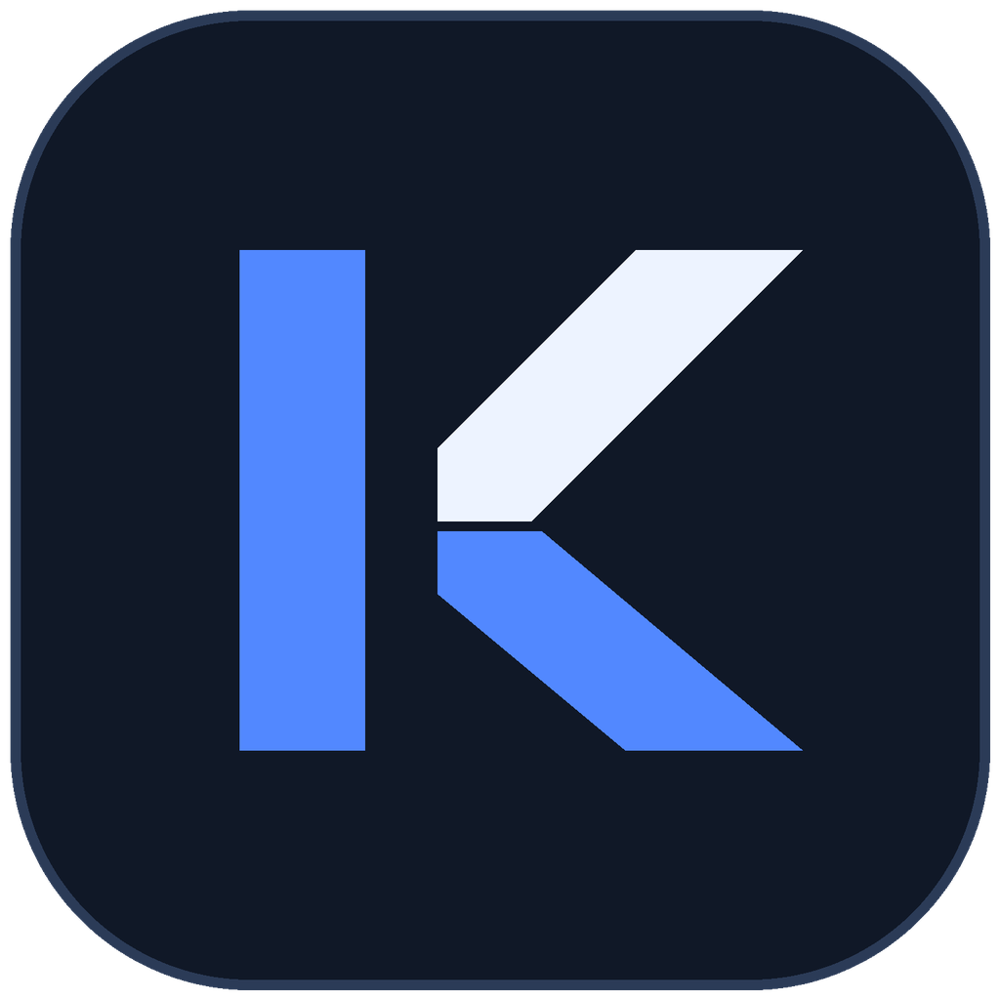
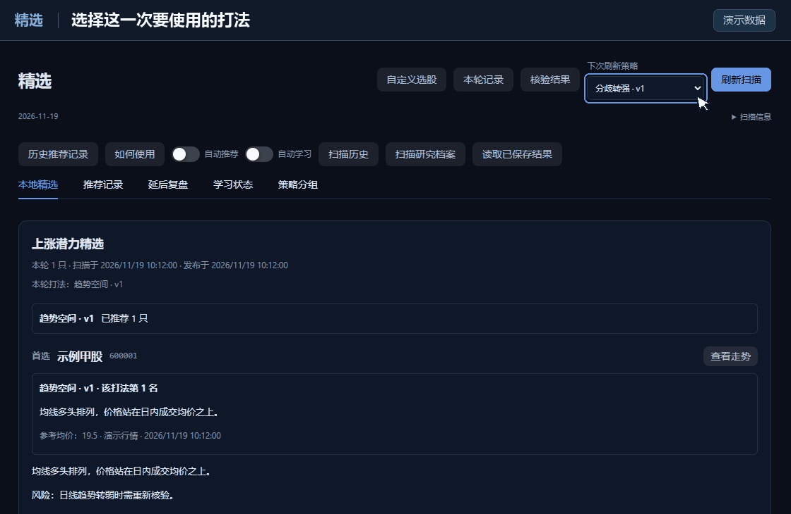
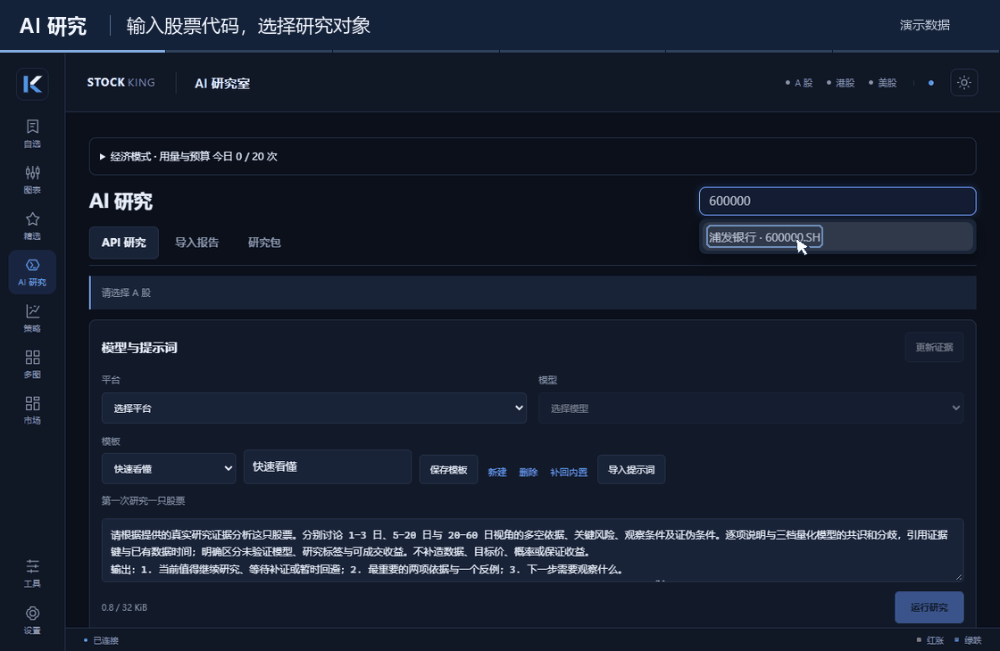

# Stock King · 本地股票研究工作台



简体中文 | [English](README.en.md)

Stock King 把 A 股选股和个股研究放在同一个桌面工作台。打开 **精选**，可以看到本轮选了哪些股票、分别因为什么入选。在 **AI 研究** 选定一只股票，就能围绕自己的问题生成报告并核对来源。支持 Windows x64 和 Apple Silicon（macOS 15+）。

[快速开始](#快速开始) · [Windows 安装](docs/WINDOWS_INSTALL.md) · [本地构建](docs/LOCAL_BUILD.md) · [AI 配置](docs/AI_CONFIGURATION.md)

## 精选 · 按打法扫描与复盘

打开 **精选 → 本地精选**，在 **下次刷新策略** 中选择一种打法或 **全部打法**，再点 **刷新扫描**。扫描完成后，**上涨潜力精选** 会显示已发布的股票、轮内名次以及入选理由。开启 **自动推荐** 后，定时扫描会运行全部已启用的打法。



动图以手动扫描「分歧转强」为例。每轮合计最多 **5 只**。同一只股票命中多种打法时，保留一张卡片，分别列出各打法的名次和证据。当日已经触及涨停的股票会被剔除，接近涨停且尚未触板的股票仍可入选。

| 打法 | 看什么 |
| --- | --- |
| 趋势空间 | 均线多头排列后，比较现价到上方压力位的空间与回落风险，也检查突破前期高点的情况。 |
| 题材先手 | 有明确时间的催化能关联到这只股票，个股先走强，随后同题材其他股票开始跟涨。 |
| 分歧转强 | 个股上冲后出现回落，随后放量修复、收复前高，修复速度领先同行。 |
| 逆势领涨 | 指数偏弱且两次下探，个股在两次下探中都比指数和同行抗跌，末段放量回升。 |

点 **历史推荐记录**，可以按打法和版本筛选，回看推荐时的行情、规则与理由，并比较 **推荐参考价、最新报价和涨跌幅**。首页和历史记录读取同一份已发布名单。想比较打法表现，可查看下一交易日收盘相对推荐价的上涨率、涨幅 ≥5% 和跌幅 ≥5% 的比例，同时核对已核验样本数。

有自己的选股条件时，打开 **自定义选股 → 导入自定义算法**，导入包含条件、排除项和排序方式的 JSON 规则，用已保存的一轮行情试跑，确认后启用。

## AI 分析 · 从一个具体问题开始

首次使用时，打开 **工具 → AI 平台配置**，添加服务后点击 **保存配置**。可以连接本地 Ollama，也可以使用兼容的云端模型。[配置说明](docs/AI_CONFIGURATION.md)

1. 打开左侧 **AI 研究 → API 研究**，按名称或代码选择一只 A 股。
2. 在 **模型与提示词** 中选择平台、模型和模板，把提示词改成自己的问题。例如，“这次反弹有成交量配合吗？哪些数据还需要核实？”点击 **运行研究**。
3. 阅读生成的报告，展开 **证据与来源** 核对行情时间。点击 **导出** 可下载 Markdown 报告，也可在同一页的 **历史** 中重新打开已保存的报告。



两段演示均使用示例数据，AI 动图中的回复为演示内容。精选在本机运行。使用云端 AI 时，所选研究内容会发送给已配置的服务商。

## 主要功能

- 图表与精选共用软件的通达信、东方财富、新浪、腾讯行情服务及缓存，保留来源时间与获取时间；关闭图表后仍可运行扫描。
- 09:20 盘前观察；09:40、09:55、10:30、14:55 独立扫描；15:30 归档与到期复盘；周五 15:45 学习，均按北京时间并检查交易日。
- 精选采用任务化学习与本地规则研究算法，深研队列按主板池的 10% 向上取整、至少 300 只且不超过实际股票数安排，每轮最多入选 5 只、不凑数；显示实际覆盖和缺口，推荐、复盘和学习全程不调用大模型。
- 数据、模型和设置保存在本机。软件不自动下单。
- 核心流程无需付费 API、云服务器或 GitHub Actions；构建和校验在自己的电脑完成。AI 可使用本地 Ollama，也可手动导入报告。

需要让 AI 工具复用同一套行情，可使用 [只读 MCP 行情服务](quote-service/README.md)。支持 Windows、macOS 的 Python 运行方式；ChatGPT 云端仍需完成远程连接授权和实测。

## 快速开始

本文开头演示的是多打法精选的源码版本。使用安装包时，可在发布说明中核对所含功能。[下载与版本说明](https://github.com/yunpengchen10/StockKing/releases)

Windows v2.7.0 提供[一键安装包](https://github.com/yunpengchen10/StockKing/releases/tag/v2.7.0)，包含本地引擎和离线 WebView2，无需安装 Python、Go 或 Node.js。参见[安装说明](docs/WINDOWS_INSTALL.md)。以下 wheel 为已有构建产物的可选安装方式。

1. 已有安装包时，Mac 用户直接解压 `Stock-King-macos-arm64.zip`，将 `Stock King.app` 放入“应用程序”并打开；看到界面左下角“已连接”即表示本地引擎已启动。此方式无需安装 Python、Go 或 Node.js。Windows 也可选择平台原生 wheel。也可从本公开仓库获取源码，按 [本地构建与分发](docs/LOCAL_BUILD.md) 在自己的电脑构建，无需 Actions、付费构建平台或云服务器。
2. 使用原生 wheel 时，安装对应平台的 64 位 Python 3.11+（推荐 3.12），在 wheel 所在目录运行（版本号变化时使用实际文件名）：

   ```text
   python -m pip install ./stock_king-2.6.0-py3-none-win_amd64.whl
   stock-king
   ```

   Apple Silicon 使用 `stock_king-2.6.0-py3-none-macosx_15_0_arm64.whl`；Python 也须为 ARM64。Windows 需要 WebView2 Runtime。Mac 也可直接使用构建产物中的 `.app` 压缩包。
3. 打开“自选”添加研究股票，在“精选 → 本地精选”选择打法并点“刷新扫描”，查看推荐理由和行情时间；点击“图表”核对同一行情链路。
4. 在“推荐记录”“延后复盘”“学习状态”查看保存的信号、T+1/3/5结果与样本积累。自动推荐和自动学习分别设置；本地模型从已记录的主板信号与对照样本学习，无需另选训练股票池。
5. 需要手动 AI 研究时再配置模型。独立“策略”页的模型研究仍需选择训练股票池，账户回测需准备行情及事前信号。

当前未发布到 PyPI；Windows 安装包见 [GitHub Releases](https://github.com/yunpengchen10/StockKing/releases)。`pip install stock-king` 不是本仓库当前的安装方式。可从公开仓库安装研究 CLI：

```text
python -m pip install "stock-king[data] @ git+https://github.com/yunpengchen10/StockKing.git@main"
stock-king doctor
```

源码安装提供研究 CLI，完整桌面请使用 Windows 一键安装包、平台原生 wheel 或 macOS `.app` 安装包。项目显示名为 **Stock King**，GitHub 仓库名为 **StockKing**；兼容现有安装的命令仍为 `stock-king`。详情见 [本地构建与分发](docs/LOCAL_BUILD.md)。

## 页面与使用流程

界面当前以中文为主；英文 README 中保留中文菜单名，便于对照操作。

| 页面入口 | 用途与操作 |
| --- | --- |
| 市场 | 查看市场概览、交易时段与研究线索，再决定今天关注哪些股票。 |
| 自选 | 搜索股票、加入或整理分组，从自选进入个股图表。自选记录不代表真实券商持仓。 |
| 图表 | 查看 K 线、技术指标与价量结构，核对当前价格、趋势和交易计划。 |
| 精选 → 本地精选 | 选择打法并刷新，查看本轮入选股票、各通道名次和触发证据。 |
| 精选 → 推荐记录 / 延后复盘 / 学习状态 | “历史推荐记录”按发布轮次保存名单、规则与推荐价。“延后复盘”和“学习状态”提供到期结果与模型验证进度。 |
| 精选 → 策略分组 | 查看原有策略分组及模型状态；使用各自的目标和训练口径。 |
| AI 研究 | 选择股票与研究模板，提取证据后手动调用已配置模型；也可导出研究包、手动导入外部 AI 报告，比较共识、分歧与证据时间。 |
| 策略 | “账户回测”导入行情和事前信号、设置费用与成交约束、查看净值及成交记录；模型研究在所选股票池内训练并检查资格状态。 |
| 多图 | 在同一工作区对比多只股票的图表。 |
| 工具 | 进入 AI 平台配置、研报与深度研究、基金研究、研究助手、计划任务、数据与工具等入口。 |
| 设置 | 管理偏好、行情刷新、通知及 AI 诊股等设置。配置修改后保存。 |

建议顺序：**市场 → 自选 → 本地精选 → 图表核验 → 推荐记录 → 延后复盘**。需要额外研究时单独进入“AI 研究”。空候选、待核验或过期都是有效状态；不要把未知数据当成已经通过，也不要把观察涨跌当成真实成交收益。

## AI 配置说明

**免费入门：** 不配置 AI 也能使用核心功能。需要本地 AI 时，在下面配置流程中使用 Ollama：Base URL 为 `http://localhost:11434/v1`，令牌填本地占位值 `ollama`，Model ID 填已安装模型的准确标签。也可在“AI 研究”导出研究包、手动导入已有报告。本地运行需要相应内存和算力；外部报告所用服务由用户自行选择。

1. 打开“工具 → AI 平台配置”，点击“添加AI配置”。也可从“设置 → AI设置”启用“AI诊股”后进入“前往管理”；该旧入口的开关不代替模型配置。
2. 填写**配置名称、接口地址（Base URL）、令牌（API Key）、模型名称（Model ID）**。接口须支持应用使用的 OpenAI 兼容 Chat Completions 格式；模型名称以服务商实际可用列表为准。
3. 点击“测试并刷新模型列表”。它检查模型列表接口，不等于已经验证模型生成回答或推理参数。
4. 抽屉中点击“确定”，再点击列表页的 **“保存配置”**，看到保存成功后再离开。
5. 返回独立“AI 研究”页，选择平台、模型和股票，再手动发起研究。远程模型调用按服务商规则计费。精选页的打法选择用于本地扫描。

| 字段 | 填写说明 |
| --- | --- |
| Base URL | 填服务商的 API 基址，保留其要求的 `/v1` 等前缀；不要填写聊天网页或追加 `/chat/completions`。 |
| API Key | 使用对应 API 平台的密钥；网页登录或聊天订阅不等于此处已配置 API 访问。仅在本机配置页填写。 |
| Model ID | 从列表选择或手动填写准确 ID，不能用显示昵称代替。 |
| Temperature / MaxTokens | 按模型能力设置采样参数与最大输出量；模型不支持某参数时，以服务商说明为准。 |
| Timeout / 深度思考 | Timeout 单位为秒；推理模型可需要更长时间。仅在模型和接口兼容时启用深度思考。 |
| HTTP 代理 | 按实际网络需要配置；模型列表测试使用通用 HTTP 客户端，不能据此确认单个配置的代理已生效。 |

完整示例、Ollama 本地配置、手动导入报告、密钥与常见错误处理见 [AI 配置说明书](docs/AI_CONFIGURATION.md)。保存的配置位于本机，但手动使用远程 AI 时，所选证据、提示词及请求内容会发送给该服务商。日常定时扫描不会自动调用 AI；自行启用的机器人或其他 AI 任务需单独管理。

## 常见问题与本地验证

| 现象 | 处理方式 |
| --- | --- |
| 旧提交仍显示失败检查 | 历史任务曾被 GitHub 账单限制阻止启动。项目现已停用 Actions，不需要开通付费额度；旧结果不会因此变为通过。 |
| 没有安装包或包已过期 | 使用维护者提供的本地构建包，或按本地构建说明重新打包；不依赖 Actions 临时产物。 |
| 引擎未就绪、行情缺失或精选为空 | 先确认网络与引擎状态，再检查报价新鲜度、交易状态和实际覆盖；必要数据不合格时允许空候选，可选因子缺失保持固定权重并标明缺口。 |
| 连接测试成功，AI 仍然报错 | 模型列表与生成回答是不同接口；检查模型权限、余额、模型 ID、推理参数及实际请求错误。 |
| 安装提示 wheel 不支持当前平台 | 核对 Windows x64 / macOS ARM64、Python 架构与 macOS 15+ 要求。Intel Mac 不在支持范围。 |

本仓库不使用 GitHub Actions，也不要求购买 GitHub Pro 或付费构建服务。本地构建脚本执行对应测试和安装校验；Windows 与 Apple Silicon 应分别在对应机器验收。操作见 [本地构建与分发](docs/LOCAL_BUILD.md)，历史失败说明见 [构建排查](docs/CI_TROUBLESHOOTING.md)。

## 历史算法与后台研究

软件 **v2.7.0** 的精选使用任务化学习及本地规则研究：每轮重新读取沪深主板非 ST 快照，按 `min(实际股票数, max(300, ceil(实际股票数 × 10%)))` 安排深研队列，最多入选 5 只。队列规模不等于完成核验数量：软件记录实际覆盖、超时和缺口。每轮重新选队列，允许新启动股票进入；未深度核验不等于已经排除。

冷启动规则为 `stockking-v1.2-rules`，按事前可观察结构选择 Early 或 MainRise 通道；所有权重固定，缺失正向分量贡献零，缺失风险按该项上界处理：

```text
FinalScore = clip(StageSelectedScore - 0.2 × DistributionRisk, 0, 100) × ObservedRegimeMultiplier
```

`0.2` 是未验证的初始风险系数。规则分不代表概率；未校准预测保持待校准。通过验证的任务模型采用独立预测和排序，不把规则百分位当作概率。详细公式与门槛见 [v2.7.0 算法说明](docs/algorithm-v270.md)，历史规则见 [V1.2 规则记录](docs/yao-v12-upgrade.md)。

| 环节 | 实际实现 |
| --- | --- |
| 共用行情 | 图表与 Python 精选通过带鉴权的本机 Go 接口共用行情和缓存，无需打开图表。统一证券代码、分钟结束时间、成交量“股”和成交额“元”，保留来源时间、获取时间及复权口径。未知成交额保留为空，不写成零。 |
| 因子计算 | 使用原始行情计算动量、同刻量能、换手、VWAP、突破、板块及风险特征。09:40 使用短窗口，15 分钟完整后启用对应因子；MAD 加零值保护，不使用未来或尚未完成的分钟。 |
| 历史覆盖与缺口 | 同刻样本达到 20 日使用完整基准；5–19 日按实际样本计算并降低置信度；不足 5 日的历史因子为空。缺少资金、催化或其他可选因子时不重新分配权重，并展示实际覆盖天数。 |
| 必要检查 | 当前报价、证券身份和必要交易状态必须有效；陈旧报价标记数据不足，停牌或无卖盘封板等不可成交对象不作为可执行推荐。09:20 仅列盘前观察，不把普通快照当作竞价字段。 |
| 先保存再展示 | 每条信号保存唯一编号、算法版本、扫描及行情时间、因子、排序、原因、风险和触发/失效条件；保留各轮入选及深度核验未入选的对照样本。同股同日汇总，重复任务幂等，手动刷新不重复计入训练。 |
| 延后复盘 | 按交易日历在 T+1、T+3、T+5 收盘后补齐观察涨跌、MFE 和正数口径的 MAE。未到期为“待复盘”，缺数据为“待补齐”。旧记录保留原口径，不补写当时未知指标，也不混入新版训练。 |
| 模拟成交 | 观察价格变化与模拟收益分开保存。模拟按信号后下一完整分钟入场、期限收盘退出，并应用账户回测的成交约束与费用；证据确认未成交时才记未成交，成交量或价格路径未知保持待补，退出受阻继续持仓复盘。模拟结果不代表用户实际交易。 |

### 本地后台任务

自动推荐与自动学习有独立开关。Windows 任务与 macOS 调度均按北京时间运行，检查交易日并跨进程去重；错过时点只记录遗漏，不补造历史推荐。

| 时间（北京时间） | 工作 |
| --- | --- |
| 09:20 | 盘前观察池 |
| 09:40 | 短窗口独立扫描 |
| 09:55、10:30、14:55 | 重新读取主板快照并独立扫描 |
| 15:30 | 当日归档及已到期的 T+1/3/5 复盘 |
| 周五 15:45 | 训练、验证和模型评估 |

### 自动学习与晋升

v2.7.0 将当日入场T+1扣费收益、次日潜伏和延续价格事件分别建模，使用Ridge收益回归、Logistic事件基线和LightGBM候选模型；概率通过独立时间段校准。软件、规则与模型分别保留版本，规则研究不显示虚构概率。

默认至少积累 **120 个成熟交易日、1000 个有效股票日**，并满足滚动开发、最终留出及完整队列要求。训练边界同时检查结果结束与证据可知时间；最终留出至少60日、50笔完成交易，之后还需至少20日和50笔完成观察的前向影子验证。收益与优势下界、回撤及概率指标未通过时不启用模型。

有效交易模型要求预期净收益与下行风险效用均为正，再按校准事件概率排序；没有优势时保留现金。旧模型只有契约兼容、数据依赖有效才可回退。全部在本机运行，不调用大模型。这些是发布门槛，不代表已获得盈利模型。详见[算法与验证口径](docs/algorithm-v270.md)。

## 量化算法

以下为独立“策略”页与策略分组中的研究模块，使用各自的训练股票池及评估目标；本地精选使用上文的信号记录与晋升流程。

| 模块 | 算法与用途 |
| --- | --- |
| 量价特征 | Alpha158 风格的收益、动量、波动、价量关系和 K 线形态特征；只使用当时及此前的数据。 |
| BalancedRank（常规） | LightGBM LambdaRank、DoubleEnsemble 式难样本重加权及 Ridge 基线，研究 5 / 20 日横截面排序；结合暴露中性化与样本外非负组合权重。 |
| SafeBound（保守） | LightGBM 分位数回归估计 20 / 60 日收益下界，配合样本外分位数校正、波动及回撤预测；使用 LightGBM、滚动波动率 / HAR 风格基线作比较。 |
| LimitPulse（激进） | LightGBM 与逻辑回归构建离散时间风险率模型，研究未来 1–3 日首次触及涨停；逐日 sigmoid 校准，再用 `1 − ∏(1 − hᵢ)` 合成累计事件概率。触板不等于可以买入或盈利。 |
| MASTER（可选挑战者） | 参考 Market-Guided Stock Transformer，组合市场引导特征门控、时间注意力与股票间注意力；使用本地训练权重，独立通过门槛后才参与。 |
| 模型评估 | 按时间滚动训练，隔离标签重叠，分离校准与检验；以 RankIC、NDCG、扣费标签收益和时间块 bootstrap 等检查质量，保留合格冠军模型。 |
| 账户回测 | 按事前信号时间、交易日历、成交限制、滑点和费税进行事件驱动模拟，支持延迟一天的对照；与模型的标签研究分开。 |

SafeBound、BalancedRank、LimitPulse 是本项目的模块名称。展示的排序分位不是胜率；历史检验、论文结果和观察涨跌均不代表实盘收益。上述独立研究模块需在用户选定的股票池上训练，不附带上游预训练权重。

## Windows

Python 3.11+ 可用 pip 从本公开仓库安装研究工具，建议 3.12。桌面 wheel 在本地电脑构建，尚未发布 PyPI。完整安装命令和平台差异见 [本地构建与分发](docs/LOCAL_BUILD.md)。

开发需要 Python、Node.js 20+、Go 1.26（版本见 `desktop/go.mod`）和 Wails 2.11。本项目的 Wails 2.11 绑定生成在 Go 1.27 上曾报错，构建脚本固定使用 Go 1.26.8。

```powershell
python -m venv .venv
.\.venv\Scripts\python.exe -m pip install -r daily-engine/requirements.txt
go install github.com/wailsapp/wails/v2/cmd/wails@v2.11.0
cd desktop
wails dev
```

构建原生桌面 wheel（无需 NSIS、Actions 或付费证书）：

```powershell
powershell -ExecutionPolicy Bypass -File scripts/build-windows-wheel.ps1
```

## macOS（Apple Silicon）

支持 Apple Silicon（M 系列）和 macOS 15+，不提供 Intel Mac 构建。构建需要原生 ARM64 的 Python 3.11 或 3.12（推荐 3.12）、Node.js 20+、Go 1.26、Xcode Command Line Tools 和 Homebrew 的 `libomp`。先确认命令行工具已安装：运行 `xcode-select -p`；若报错，运行 `xcode-select --install` 并等待系统安装完成。若没有 `brew` 命令，先按 [Homebrew 官方安装说明](https://brew.sh/)安装。再从 [Python 官方 macOS 下载页](https://www.python.org/downloads/macos/)安装 universal2 版本的 Python；如果已安装可用的 ARM64 Python，可跳过这一步。

```bash
brew install node go@1.26 libomp
export PATH="$(brew --prefix go@1.26)/bin:$PATH"
git clone https://github.com/yunpengchen10/StockKing.git
cd StockKing
bash scripts/build-macos.sh
```

脚本会检查 Python 版本与架构，自动安装 Wails 2.11，并在现有 `.venv` 不兼容时重建。只有 Python 3.11 可用时，可运行 `PYTHON_BIN=python3.11 bash scripts/build-macos.sh`。若终端通过代理上网，请在构建前设置实际可用的 `HTTPS_PROXY` 和 `HTTP_PROXY`；系统设置中的代理不一定会被终端工具使用。首次构建需下载并编译较大的前端、Go 和 Python 依赖，会花较长时间。

产物为 `artifacts/macos/Stock-King-macos-arm64.zip` 及 `dist/desktop/` 中的 wheel。解压 ZIP，把 `Stock King.app` 放入“应用程序”并打开，确认界面显示“已连接”。脚本在非云同步的临时目录签名，避免 `Documents` 等目录的扩展属性导致签名失败。这是本地临时签名的构建，不要求购买开发者证书，尚无 Apple 公证；首次打开可能需要在“系统设置 → 隐私与安全性”中允许。

如需独立后台任务，在源码目录执行以下命令（关闭软件窗口后仍可运行）：

```bash
python3 scripts/install-macos-schedule.py
# 停用：python3 scripts/install-macos-schedule.py --remove
```

后台任务是安装 `.app` 后单独启用的，默认寻找 `/Applications/Stock King.app`。需保持电脑开机、唤醒并登录。工作日 09:10、09:30、09:45、10:20、14:45 开始准备，对应 09:20 观察和 09:40、09:55、10:30、14:55 扫描；15:30 归档复盘，周五 15:45 学习。Mac 使用哪个时区都按北京时间调度，错过的盘中时点不会补造推荐。原生 wheel 为 `macosx_15_0_arm64`，包含 LightGBM 和 MASTER 所需 PyTorch。

<details>
<summary>历史版本与早期研究回放</summary>

## v2.9.1 更新

2026-11-13：精选复用市场模块的题材事件、概念资金采集记录和资讯。默认页面收拢为“今日主线、重点股票、昨日反馈”，详细研究和诊断折叠。重点观察采用有原始日期的题材线索与当日真实报价，不再被全概念覆盖不足一并清空；资金与买点是否满足独立标注。昨日事件标明“昨日题材今日跟踪”，观察股单独冻结参考价并在收盘反馈。修复题材行情目录仍限主板、遗漏创业板和科创板成员的问题。详见[市场数据复用与精选简报](docs/market-brief-v291.md)。

## v2.9.0 更新

2026-11-13：机会精选改为“热门题材 → 题材核心股 → 资金走势与买入位置”，首页展示今日主线与每日反馈。收盘保留选中和未选对照，区分题材走弱、首轮选股落后及漏选强股；至少三个独立日期的有效反馈才会有限调整次日题材优先级。题材数据缺失不回退行业，历史记录不重写，规则排序不代表胜率。详见[数据来源、反馈规则与验证边界](docs/theme-first-feedback-v290.md)。

## v2.8.0 历史更新

2026-10-29 修订：新增 E（早期启动）/M（主升确认）机会精选，修复单分钟弱反弹误入选、突破结构失效后仍入选和负比较基准放大排序的问题。推荐记录默认与当前精选绑定同一轮名单，并自动同步新扫描；历史记录保留原始证据和推荐参考价。详见[机会规则、同步修复与验证](docs/opportunity-em-2.8.0.md)。源码更新不会自动替换旧 Release 安装包；测试通过不代表已证明收益改善。

### v2.7.2 历史更新

2026-10-26 修订：修复旧目录日期误阻断新报价市场广度的问题；行业分钟采集优先补齐可核验覆盖，保留完整行业分母与80%门槛；合格分钟研究对照不再被同股日线记录覆盖。精选新增当前模型准备状态、实际入池计数与独立冷启动研究区。正式推荐仍需通过T+1模型验证，更新不代表立即产生推荐或提高收益。详见[修订与验证](docs/admission-repair-v272.md)。

### v2.7.1 历史更新

2026-10-26 修订：按字段源时重排全池初筛，独立补评到期日线观察，冻结未入选对照的当时报价；学习按数据、特征和标签契约审核兼容性，显示实际滚动切分缺口。T+1 净盈利与至少 5% 收益分别校准，新增冻结入场区间和五组前向因子对照。详见[修订及验证口径](docs/recommendation-reliability-v271.md)。旧 Release 安装包不会随源码提交自动更新。

### v2.7.0 历史更新

2026-10-19 算法修订：日线推荐增加现价高于昨收、开盘和当日 VWAP 的方向门禁；分钟研究记录 15/30 分钟路径效率、回撤、回吐、量价代理和 VWAP 占比。新指标保持研究状态，不把盘口快照当作主力身份或胜率。详见[数学定义与验证边界](docs/MAIN_RISE_MATH_20261019.md)。历史 Release 安装包不随 `main` 源码更新而自动变化。

- **可信数据：** 核验分钟行情证券身份和独立报价，冲突整日隔离，保存数据版本与依赖。
- **任务化学习：** 当日入场的T+1扣费收益、次日潜伏与延续价格事件分别拟合；包含Ridge、Logistic和LightGBM，经过时间校准、滚动检验与前向影子验证才启用。
- **风险与空仓：** 执行总预算、单股与行业上限；模型无优势时允许零只，未入选对照持续保留。
- **记录与复盘：** 修复`Illegal invocation`，读取超时后可重试；自动补充复盘证据，区分训练检查、完成拟合和模型启用。

新增代码通过测试不代表已经证明收益改善；样本不足时明确显示规则研究状态。参见[完整算法与验证口径](docs/algorithm-v270.md)。

[工作台操作总览](docs/WORKSPACE_TOUR.md) · [早期行情研究回放](docs/research/stockking-v11-market-sample.md)

</details>

## 致谢与引用

感谢以下作者、团队及各项目的全部贡献者。Stock King 在这些工作的基础上集成和改造，保留了相应版权与许可声明。

| 作者 / 团队 | 项目与贡献 |
| --- | --- |
| [ArvinLovegood](https://github.com/ArvinLovegood) 及贡献者 | [go-stock](https://github.com/ArvinLovegood/go-stock)：Go / Wails / Vue 桌面基础（GPL-3.0）。 |
| [ZhuLinsen](https://github.com/ZhuLinsen) 及贡献者 | [Daily Stock Analysis](https://github.com/ZhuLinsen/daily_stock_analysis)：研究引擎（MIT）；[AlphaSift](https://github.com/ZhuLinsen/alphasift)：筛选引擎与策略材料（Apache-2.0）。 |
| Tong Li、Zhaoyang Liu、Yanyan Shen、Xue Wang、Haokun Chen、Sen Huang / SJTU-DMTai | [MASTER](https://github.com/SJTU-DMTai/MASTER)：《MASTER: Market-Guided Stock Transformer for Stock Price Forecasting》，AAAI 2024；市场引导注意力架构参考（MIT）。 |
| Microsoft Qlib 团队及贡献者 | [Qlib](https://github.com/microsoft/qlib)：Alpha158 风格特征、DoubleEnsemble 思路及量化研究方法参考；这里是本地实现，不宣称完整复现。 |
| LightGBM、PyTorch、scikit-learn 的作者与维护者 | [LightGBM](https://github.com/lightgbm-org/LightGBM)、[PyTorch](https://github.com/pytorch/pytorch)、[scikit-learn](https://github.com/scikit-learn/scikit-learn)：训练、排序、深度学习与统计建模基础。 |
| AKShare、Wails、Vue、Naive UI 及相关依赖的维护者 | [AKShare](https://github.com/akfamily/akshare) 等数据接口，以及桌面与界面技术生态。 |

完整许可说明见 [第三方声明](THIRD_PARTY_NOTICES.zh-CN.md) 和 [licenses/](licenses/)。

## 开发与许可

桌面端位于 `desktop/`，研究引擎位于 `daily-engine/`。修改后运行相关 Python 测试、前端 `npm test` 和桌面 `go test .`。

方法说明见 [研究流程](docs/RESEARCH_WORKFLOW.md)、[可执行回测](docs/EXECUTABLE_BACKTEST.md)。工程边界见 [INTEGRATION.md](INTEGRATION.md)。

项目许可见 [LICENSE](LICENSE)，上游与第三方许可见 [THIRD_PARTY_NOTICES.zh-CN.md](THIRD_PARTY_NOTICES.zh-CN.md)。仅供研究，不构成投资建议或收益承诺。
